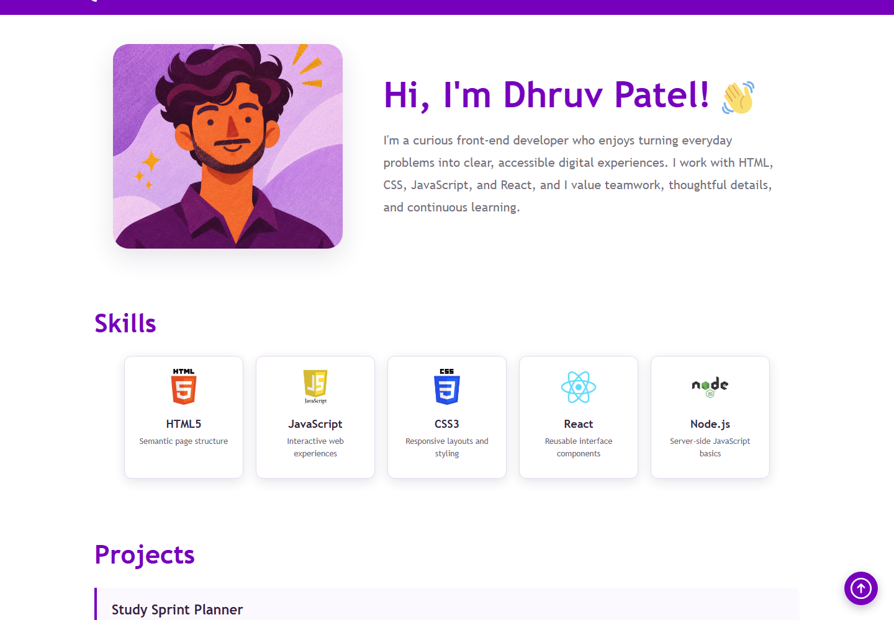
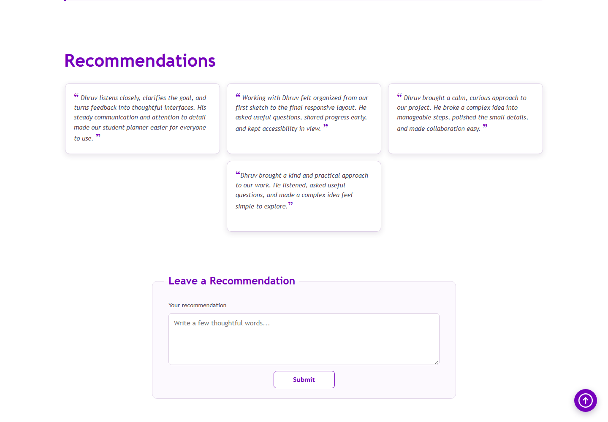
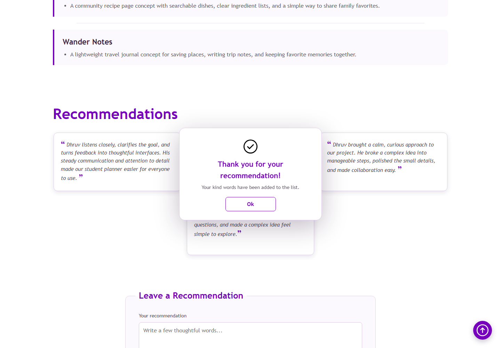
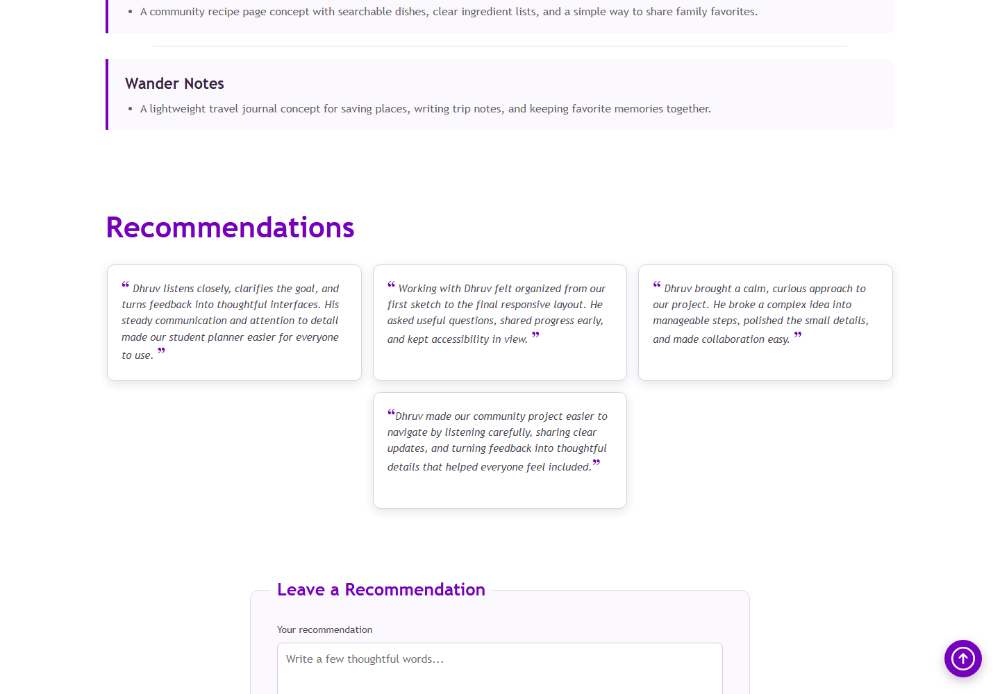
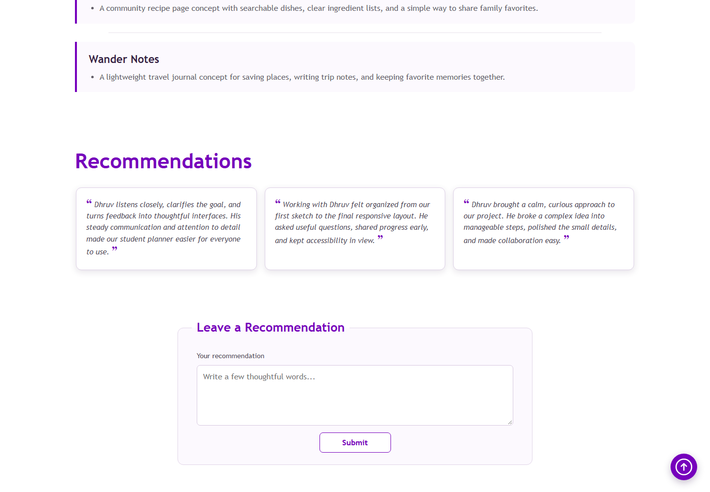
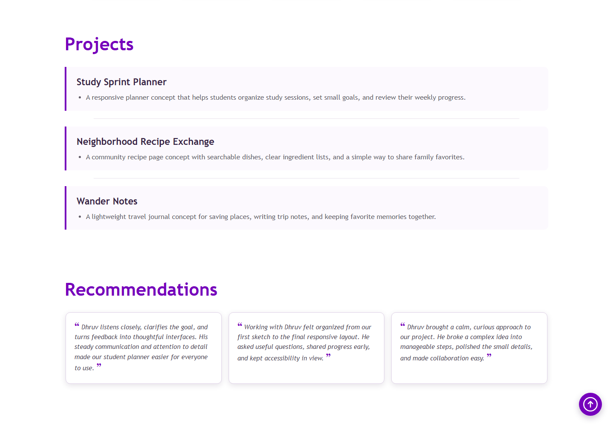
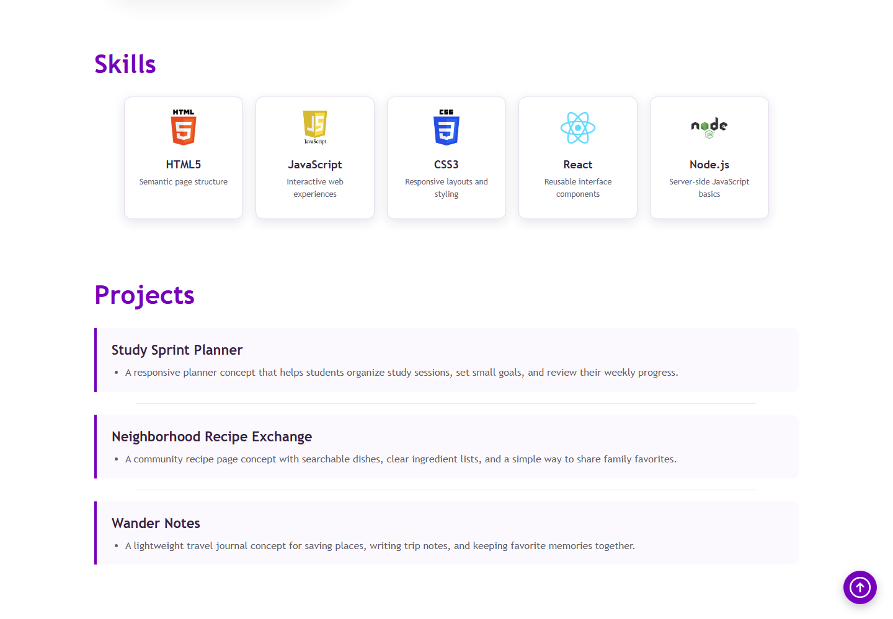
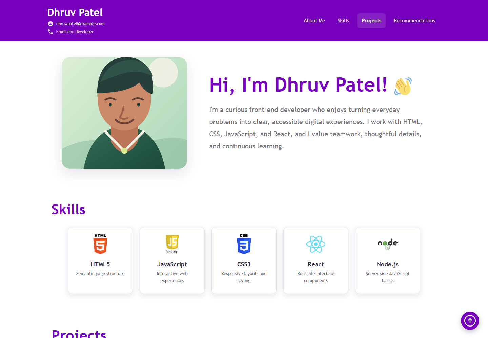
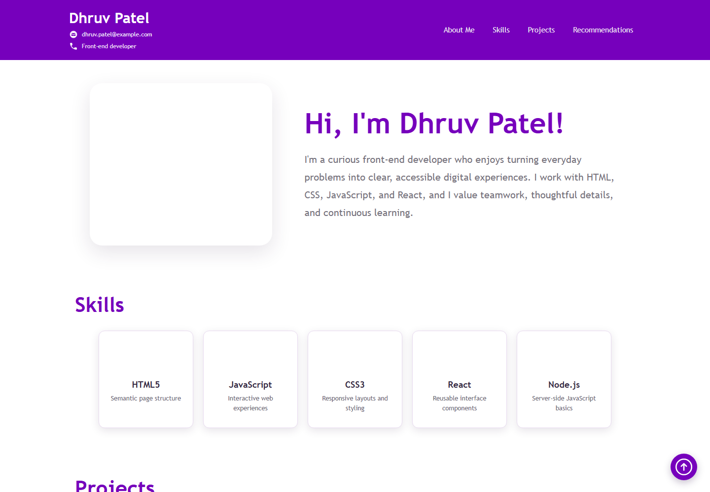

# Dhruv Patel — Portfolio

A responsive personal portfolio built with HTML, CSS, and JavaScript.

**Live site:** https://dexter16-o.github.io/my-portfolio/

## About

The site introduces Dhruv Patel, highlights front-end development skills and project concepts, and includes a form for adding recommendations.

## Run locally

Open `index.html` in a web browser.

## Image gallery

Selected portfolio images:

|  |  |  |
| --- | --- | --- |
|  |  |  |
|  |  |  |
|  |  |  |
|  |  |  |
